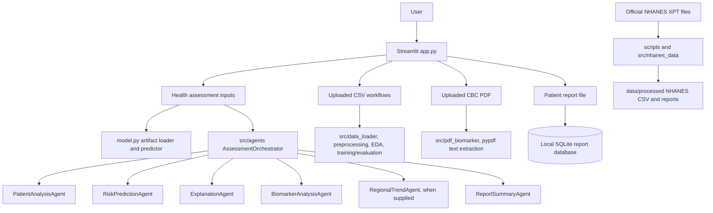

# System Architecture

## Overview

The application is a single-process Streamlit dashboard. The sidebar radio selects a page and `app.py` calls that page's rendering function. The app imports analysis and persistence code from `src/`, and prediction functions from `model.py`. There is no distributed agent runtime, message broker, autonomous agent loop, or external LLM integration found in the reviewed implementation.

## Component flow

The orchestrator instantiates six separately implemented local classes: patient analysis, risk prediction, explanation, biomarker analysis, regional trends, and report summary. It passes Python dictionaries/DataFrames among those classes and combines their return values. “Agent” here is the project's module naming convention; these classes are ordinary deterministic Python components, not independent or LLM-driven agents.

## Main modules

| Area | Files | Responsibility |
|---|---|---|
| User interface | `app.py`, `.streamlit/config.toml` | Sidebar routes, forms, tables, charts, upload controls, display and downloads. |
| Prediction | `model.py`, `src/model_training.py`, `src/model_evaluation.py`, `src/preprocessing.py`, `train_model.py` | Artifact loading, feature-row prediction, model comparison and persistence. |
| Data exploration | `src/data_loader.py`, `src/eda.py` | CSV validation, quality summaries, plotting, categorical and numeric descriptions. |
| NHANES workflow | `scripts/download_nhanes.py`, `scripts/prepare_nhanes.py`, `src/nhanes_data.py`, `config/` | Fetch/provenance handling, XPT merge, cohort derivation and descriptive reports. |
| Health modules | `src/biomarker_analysis.py`, `src/pdf_biomarker.py`, `src/disease_risk.py`, `src/regional_analysis.py` | Biomarker descriptions, conservative PDF text extraction, label inventory and counts. |
| Patient reports | `src/patient_records.py` | Local SQLite BLOB persistence, lookup, download, deletion and reference validation. |
| Agent components | `src/agents/*.py` | Local callable components coordinated by `AssessmentOrchestrator`. |
| Legacy explanation | `utils/explanation.py` | Rule context, explicitly presented as a demonstration. |

## Persistence and external services

Assessment values are kept in the Streamlit session for display/summary. Uploaded patient documents are persisted as SQLite BLOBs in the user's local application-data folder (Windows default: `%LOCALAPPDATA%\AIHealthScoring\patient_reports.sqlite3`), not in the repository by default. Storage is not encrypted and has no app authentication or authorization.

The hospital button constructs a Google Maps search link using typed area text, or “hospital near me” when blank. It does not query a Places API, read device GPS itself, produce a verified facility list, or report distance/availability. Browser and Google Maps behavior requires a working browser/network and any required browser permission. It is not emergency response.

## Diagram and screenshot placement

No screenshots or exported diagrams were present in the reviewed checkout. The Mermaid diagram above is source documentation. If captured after a successful run, place architecture exports under `documentation/figures/architecture.png` and page screenshots under `documentation/screenshots/` (for example `home.png`, `assessment.png`, `patient_reports.png`, `data_eda.png`, `biomarker_pdf.png`, `regional_trends.png`, and `model_performance.png`). These paths are recommendations only; no images are claimed to exist.
